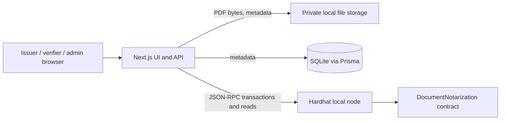
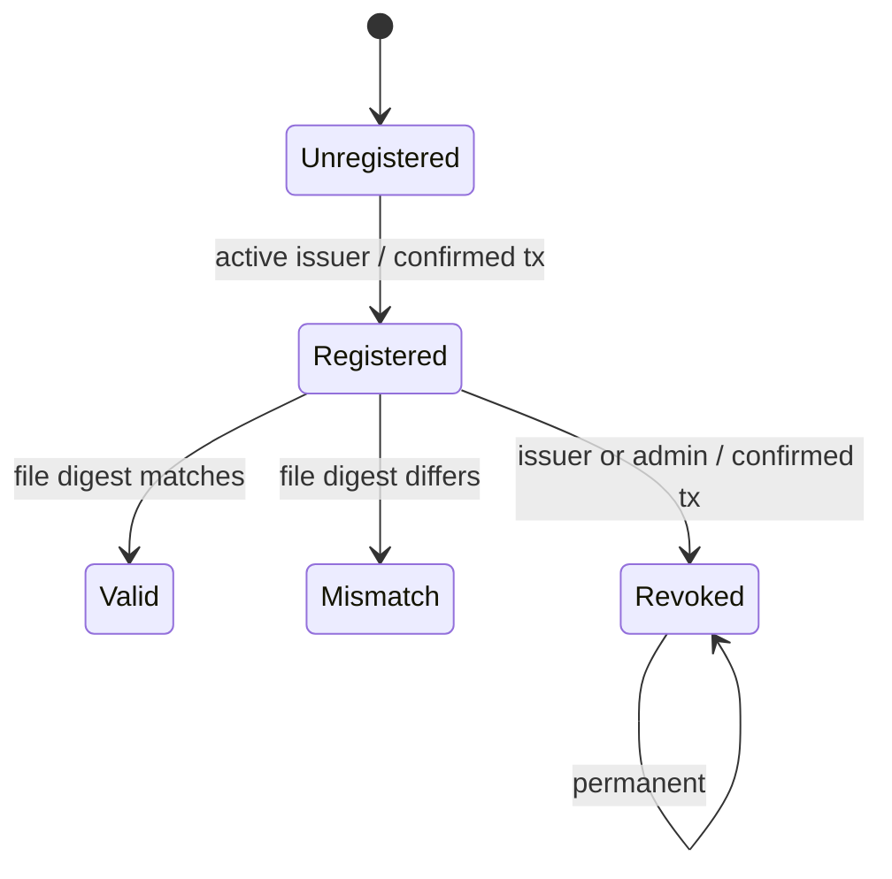
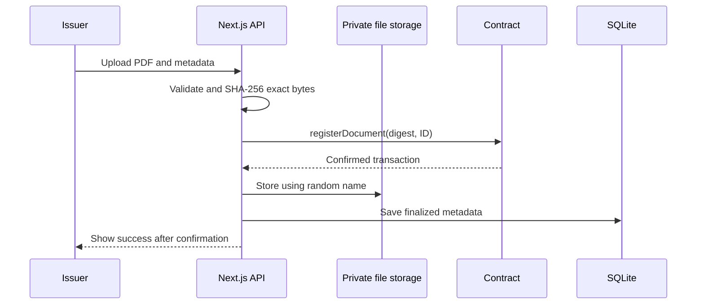

# ChainProof — Blockchain-Based Certificate and Document Notarization System

## Abstract

ChainProof is an academic prototype that stores a PDF's SHA-256 digest and registration metadata in smart-contract state. A verifier uploads a candidate PDF and compares its digest with the contract record. An authorized issuer can register documents; the administrator manages issuer permissions; the issuer or administrator can revoke a registration. Documents remain in private local storage. The system demonstrates tamper evidence for file bytes, not the truth of document claims or issuer identity.

## Introduction and problem statement

Forged or altered certificates can be difficult to detect when verification depends on manual issuer contact. ChainProof provides a repeatable integrity check against an earlier registration transaction. A successful match shows that the uploaded bytes match the bytes represented by the registered digest.

## Objectives and scope

- Calculate SHA-256 from the exact uploaded PDF bytes.
- Record a unique document ID, digest, issuer and timestamp on-chain.
- Manage issuer authorization and permanent revocation.
- Verify by ID and file, and link to verification from a QR code.
- Run without paid services on a local Hardhat chain and SQLite database.

The prototype does not implement production identity verification, cloud storage, multi-organization governance, PDF semantic normalization, or a public deployment. A PDF re-save or metadata edit can alter bytes and therefore the hash.

## Existing system and proposed system

Manual checking can be slow and dependent on office availability. ChainProof provides public, deterministic digest comparison and an append-only transaction history on the selected chain. It cannot itself determine whether a credential was legitimately issued.

## Use cases and actors

- **Administrator:** authorizes, suspends, or reactivates issuer addresses; may revoke documents.
- **Issuer:** registers PDF digests and may revoke its own records.
- **Verifier:** searches a document ID or uploads a PDF for byte comparison.
- **Local Hardhat node:** executes the contract during the demonstration.

## Blockchain and architecture

The required demo uses a **local Hardhat development network**, chain ID 31337. It is an isolated development chain, not a public blockchain. Hardhat local execution uses its development node and does not represent Polygon consensus. Optional future deployment to Polygon Amoy would use the Polygon PoS test network and its PoS consensus/validator environment; no Amoy deployment is implemented or claimed here.

## Contract and functions

`DocumentNotarization` records document digests under a `keccak256(documentId)` lookup key. The human-readable ID is emitted in events and retained in app metadata. Public functions include `authorizeIssuer`, `suspendIssuer`, `reactivateIssuer`, `isAuthorizedIssuer`, `registerDocument`, `revokeDocument`, `getDocument`, and `verifyDocument`. The administrator is the deployer. Registration requires an active issuer and a nonzero digest. Duplicate IDs are rejected. Revocation is permanent and permitted to the administrator or original issuer. Suspension affects future registrations and leaves existing records unchanged.

## Oracle, nodes, consensus, and block data

No oracle is needed: the server can hash the submitted bytes and the contract compares a supplied digest to contract state. An oracle would be required only if the contract needed external facts unavailable to the chain.

In local demo operation, the Hardhat node creates blocks as it executes development transactions. There are no independent public validators or economic consensus guarantees. A transaction carries a call to contract code; the contract's persistent storage contains the digest, issuer, timestamp, existence, and revoked flag. The entire PDF is never stored in a block or in contract state. Event logs record registration, issuer changes, and revocation for history.

## On-chain and off-chain data

On-chain: digest, issuer address, timestamp, existence/revocation state, and events. Off-chain SQLite: title, category, original filename, transaction/network details, timestamp and private storage reference. Off-chain local filesystem: original PDF, stored with a random name outside public static directories. No name, phone, email, or full certificate is placed on-chain.

## Workflows

Verification retrieves the contract record and compares a server-computed digest. Missing IDs are `NOT_FOUND`; mismatches are `HASH_MISMATCH`; revoked records remain `REVOKED`; RPC errors fail closed. ID-only lookup displays `REGISTERED` rather than claiming the file is valid. Revocation first confirms the chain transaction, then updates local metadata.

## Security aspects

The contract enforces roles; server routes validate inputs and upload size, require either PDF MIME type or a `.pdf` filename, and check the PDF signature; filenames are randomized; files are stored outside public directories; server hashing ignores client-provided digests; success requires transaction confirmation; verification reads contract state. Local role-specific tokens issue signed, eight-hour HttpOnly sessions, and server routes validate the session role. This remains demo authentication and development key custody, not production identity.

## Implementation details and results

The repository uses Next.js App Router, TypeScript, ethers v6, Hardhat, Solidity, Prisma and SQLite. Dashboard counts are reconciled against the on-chain record state; metadata lists omit the original filename and storage reference. On 25 October 2026, the executed test suite passed all 5 contract tests and all 6 application tests covering PDF hashing/validation, safe error handling, verification status, and chain ID. The local smoke workflow passed registration, exact-file verification, changed-byte mismatch, permanent revocation, unknown-ID checks, anonymous and wrong-role dashboard/issuer-route denial, metadata redaction, and private-file path checks against the deployed chain. Prisma schema validation succeeded. The optimized Next.js production build succeeded, and lint reported no warnings or errors.

## Expected versus demonstrated outcomes

Expected: an end-to-end local demonstration of issuer authorization, digest registration, verification, mismatch detection, permanent revocation, unknown-ID handling, and QR navigation. Demonstrated in this environment: the contract was deployed to local Hardhat at `0x5FbDB2315678afecb367f032d93F642f64180aa3` (chain ID 31337), issuer authorization succeeded, and the app smoke workflow passed registration, valid verification, mismatch, revocation, and not-found checks. QR generation is implemented on document detail pages; scanning from another device requires `APP_URL` to use a reachable LAN address.

## Limitations and future enhancements

SQLite and local file storage are single-machine demo components. Role-specific local tokens issue signed, eight-hour HttpOnly sessions, but they do not establish real-world identity and private-key custody remains rudimentary. The project has no production threat review. Future work could add institutional identity and wallet-signature sessions, encrypted object storage, robust database transactions/outbox reconciliation, independent RPC providers, rate limits, monitoring, accessibility review, and audited deployment to a suitable network.

## Conclusion

ChainProof shows how a blockchain can provide a shared tamper-evident reference for document bytes while keeping the document itself off-chain. Its trust boundary is explicit: digest matching proves byte equality with a prior registration, while issuer legitimacy and document truth remain external questions.

## References

- Solidity documentation: https://docs.soliditylang.org/
- Hardhat documentation: https://hardhat.org/docs
- ethers documentation: https://docs.ethers.org/
- SHA-2, NIST FIPS 180-4: https://csrc.nist.gov/pubs/fips/180-4/upd1/final
- Prisma documentation: https://www.prisma.io/docs/
- Polygon PoS documentation: https://docs.polygon.technology/pos/
